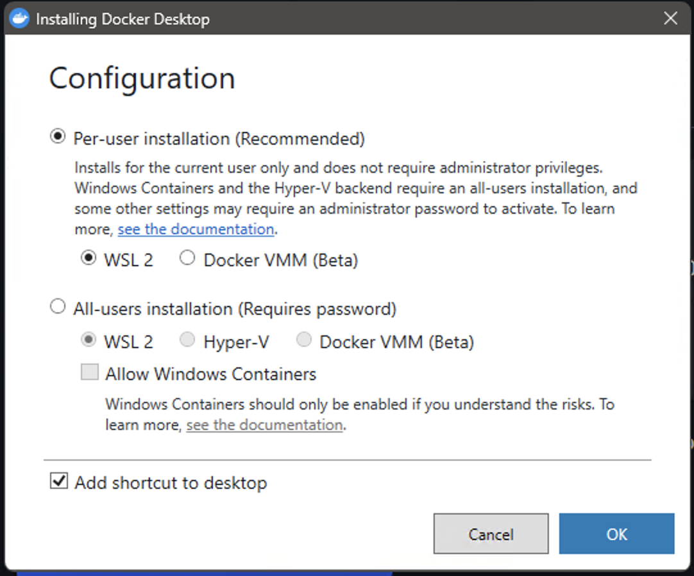
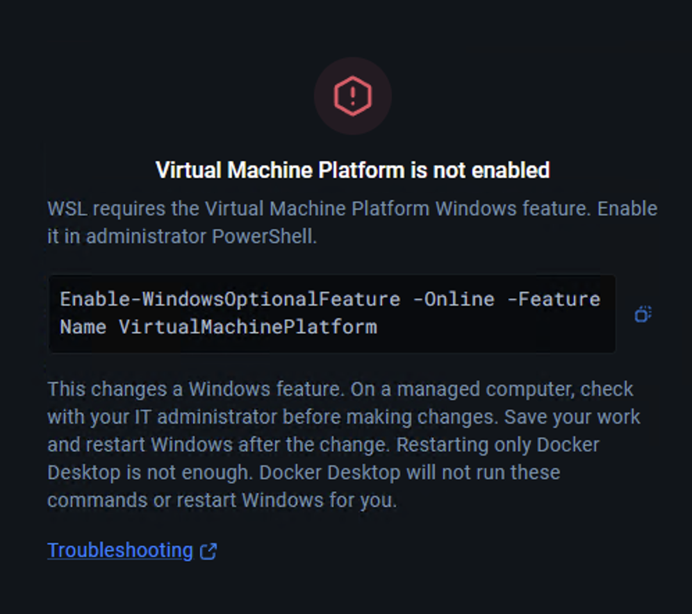
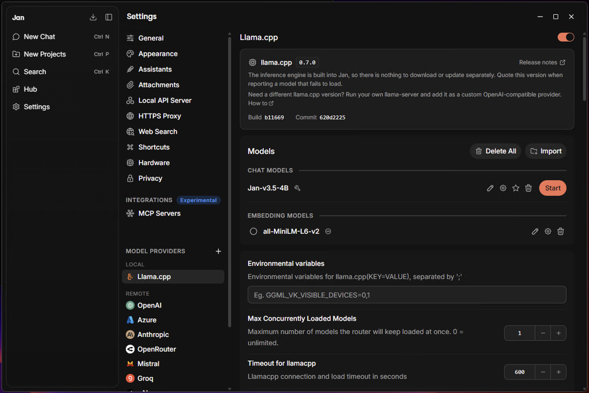
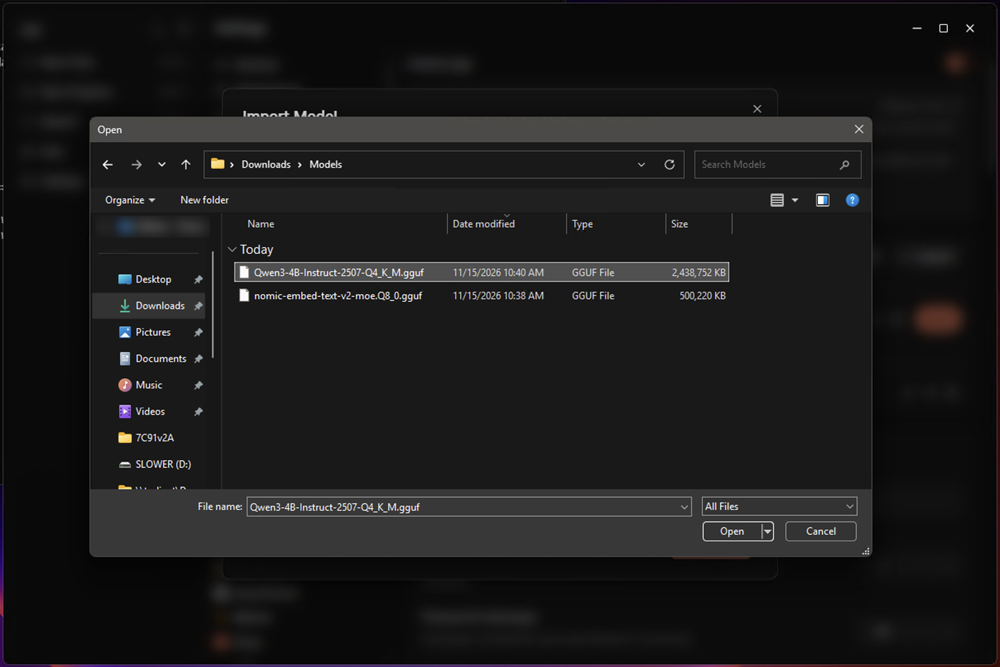
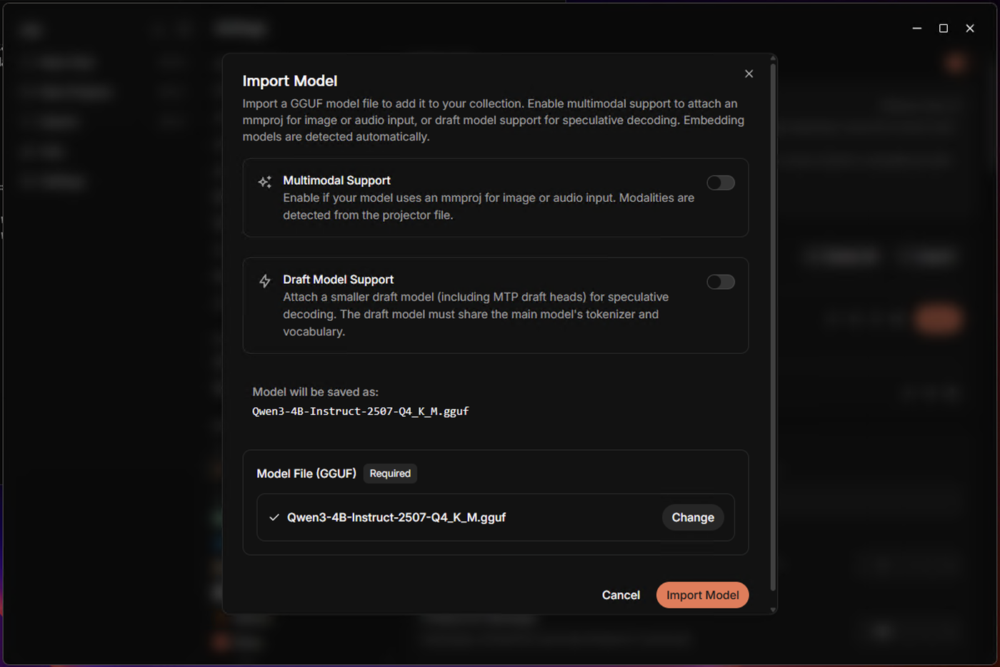
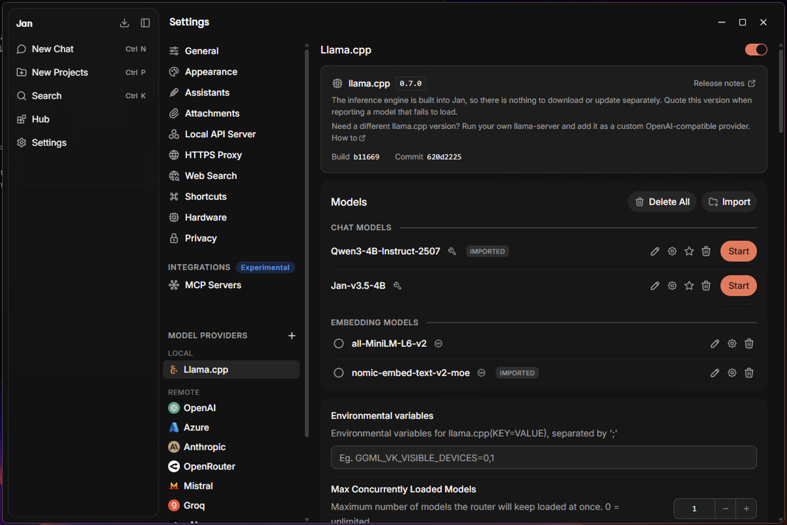
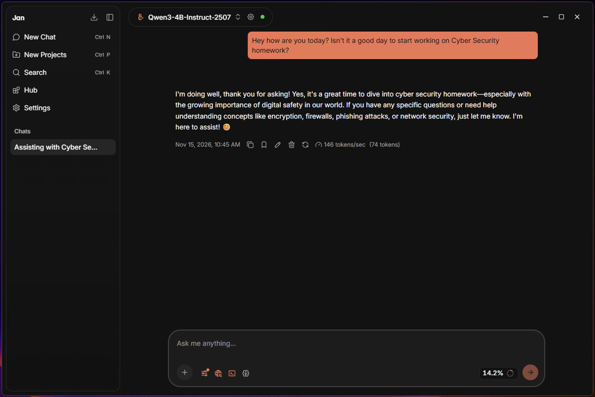
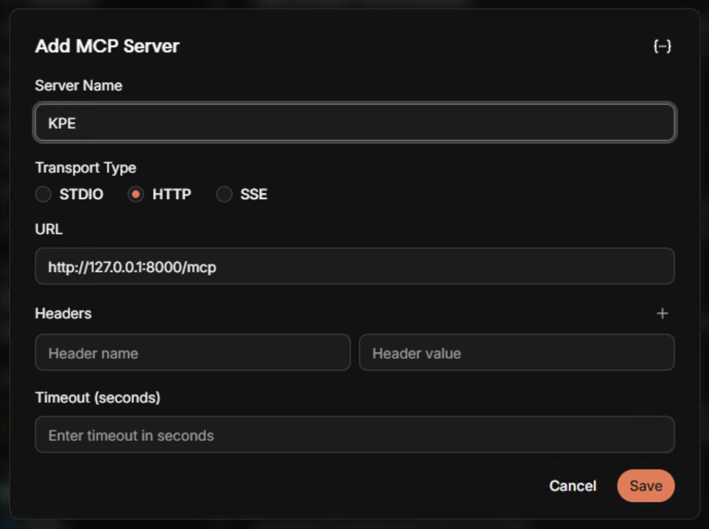

# Trabajo Final

**Análisis del caso "Kilometreados Pero Enteritos"**

Este repositorio es el material del proyecto final del curso CIB-203 Seguridad Defensiva y Ofensiva de la Universidad CENFOTEC.

Esta es una copia del sistema de la compañía ficticia KPE S.A., conocida como Kilometreados Pero Enteritos S.A., una venta de carros usados 100% en línea en Heredia. KPE sufrió un incidente de seguridad relacionado con su asistente de inteligencia artificial, Guachimán. Cada grupo de ustedes fue contratado como firma consultora para investigar este incidente de seguridad.

> **¡Importante!** La aplicación es vulnerable a propósito. Úsenla solo en su propio equipo. Todos los datos son ficticios, y también lo son los dominios `.test` y las direcciones IP de los registros. Recuerden que ejecutar técnicas de ataque contra sistemas reales puede ser un delito en Costa Rica :)

## Contenido

1. [¿Qué incluye este repositorio?](#qué-incluye-este-repositorio)
2. [Requisitos de software y hardware para ejecutar el ejercicio](#requisitos-de-software-y-hardware-para-ejecutar-el-ejercicio)
3. [Descarga y configuración automatizada](#descarga-y-configuración-automatizada)
4. [Configurar Jan](#configurar-jan)
5. [¿Cómo levantar localmente el sistema?](#cómo-levantar-localmente-el-sistema)
6. [Entrar al sistema](#entrar-al-sistema)
7. [El copiloto MCP](#el-copiloto-mcp)
8. [¿Cómo detener el sistema?](#cómo-detener-el-sistema)
9. [Problemas comunes](#problemas-comunes)
10. [Opcional, el código fuente en su equipo](#opcional-el-código-fuente-en-su-equipo)

## ¿Qué incluye este repositorio?

| Elemento | Para qué sirve |
|---|---|
| Copia de la base de datos del sistema | Los datos de KPE tal como estaban el 2 de noviembre de 2026 a las 2:10 p. m. Se cargan solos la primera vez que levantan el sistema |
| El código fuente | El código de la aplicación, el sitio web y los archivos para levantarla con Docker |

Para usar el sistema no hace falta clonar el repositorio. El sistema corre con imágenes de Docker ya publicadas, y los comandos de la sección [Descarga y configuración automatizada](#descarga-y-configuración-automatizada) bajan todo lo necesario.

## Requisitos de software y hardware para ejecutar el ejercicio

| Elemento | Detalle |
|---|---|
| Sistema operativo | Windows 10 u 11, macOS en Apple Silicon o Linux |
| Memoria | 16 GB de RAM recomendados |
| Tarjeta de video | NVIDIA con 6 GB de VRAM o una Mac con Apple Silicon. Puede funcionar con AMD, pero no se probó. Sin tarjeta de video funciona, pero más lento |
| Docker | Docker Desktop. En Windows se recomienda la instalación con WSL 2. Guía de instalación para Windows en https://docs.docker.com/desktop/setup/install/windows-install/ |
| Jan | La aplicación de escritorio que corre los modelos de inteligencia artificial en su equipo. Se descarga en https://www.jan.ai/download |
| Disco | 10 GB libres |

### Instalar Docker Desktop en Windows

Cuando el instalador muestre la pantalla **Configuration**, dejen escogidas las opciones **Per-user installation** y **WSL 2**, como en la imagen, y presionen **OK**.

<p align="center"></p>

Si al abrir Docker Desktop aparece el mensaje **Virtual Machine Platform is not enabled**, falta activar una función de Windows que WSL 2 necesita. Se activa con un comando que solo funciona en una ventana de PowerShell abierta con permisos de administrador.

<p align="center"></p>

1. Guarden su trabajo, porque al final hay que reiniciar Windows.
2. En el menú Inicio busquen **PowerShell**, denle clic derecho y escojan **Ejecutar como administrador** (en Windows en inglés, **Run as administrator**).
3. En esa ventana de PowerShell con permisos de administrador peguen este comando y presionen Enter. El título de la ventana debe empezar con **Administrador** (en inglés, **Administrator**). En una ventana normal de PowerShell el comando falla.

   ```
   Enable-WindowsOptionalFeature -Online -FeatureName VirtualMachinePlatform
   ```

4. Cuando termine, reinicien Windows. Reiniciar solo Docker Desktop no alcanza.
5. Abran Docker Desktop de nuevo.

## Descarga y configuración automatizada

Copien en la terminal el bloque de comandos de su sistema operativo. Cada bloque crea la carpeta `kpe` en su carpeta personal y deja ahí todo lo que el sistema necesita.

- `docker-compose.yml`, que le dice a Docker cómo levantar el sistema.
- Los modelos, en la carpeta `kpe/models`. En Mac solo el de embeddings, porque el de chat se baja desde Jan.
- `.env`, un archivo de texto plano con los nombres de los modelos que el sistema usa.

Los modelos pesan unos 3 GB, así que la descarga tarda unos minutos.

### Windows

Abran **PowerShell** (no hace falta como administrador) y peguen este bloque.

```
New-Item -ItemType Directory -Force "$HOME\kpe\models" | Out-Null
Set-Location "$HOME\kpe"
curl.exe -fL -o docker-compose.yml https://raw.githubusercontent.com/wrodriguez-cenfotec/KPE/v0.1.0/docker-compose.yml
curl.exe -fL -o models\Qwen3-4B-Instruct-2507-Q4_K_M.gguf https://huggingface.co/unsloth/Qwen3-4B-Instruct-2507-GGUF/resolve/main/Qwen3-4B-Instruct-2507-Q4_K_M.gguf
curl.exe -fL -o models\nomic-embed-text-v2-moe.Q8_0.gguf https://huggingface.co/nomic-ai/nomic-embed-text-v2-moe-GGUF/resolve/main/nomic-embed-text-v2-moe.Q8_0.gguf
Set-Content -Path .env -Encoding ascii -NoNewline -Value "LLM_CHAT_MODEL=Qwen3-4B-Instruct-2507-Q4_K_M.gguf`nLLM_EMBED_MODEL=nomic-embed-text-v2-moe.Q8_0.gguf`n"
```

### Linux

Abran una terminal y peguen este bloque.

```
mkdir -p ~/kpe/models && cd ~/kpe
curl -fL -o docker-compose.yml https://raw.githubusercontent.com/wrodriguez-cenfotec/KPE/v0.1.0/docker-compose.yml
curl -fL -o models/Qwen3-4B-Instruct-2507-Q4_K_M.gguf https://huggingface.co/unsloth/Qwen3-4B-Instruct-2507-GGUF/resolve/main/Qwen3-4B-Instruct-2507-Q4_K_M.gguf
curl -fL -o models/nomic-embed-text-v2-moe.Q8_0.gguf https://huggingface.co/nomic-ai/nomic-embed-text-v2-moe-GGUF/resolve/main/nomic-embed-text-v2-moe.Q8_0.gguf
printf 'LLM_CHAT_MODEL=Qwen3-4B-Instruct-2507-Q4_K_M.gguf\nLLM_EMBED_MODEL=nomic-embed-text-v2-moe.Q8_0.gguf\n' > .env
```

### Mac con Apple Silicon

Abran la aplicación **Terminal** y peguen este bloque. En Mac el modelo de chat no se baja aquí, se baja desde Jan en el paso siguiente. El archivo `.env` queda con el nombre del modelo de chat para Mac.

```
mkdir -p ~/kpe/models && cd ~/kpe
curl -fL -o docker-compose.yml https://raw.githubusercontent.com/wrodriguez-cenfotec/KPE/v0.1.0/docker-compose.yml
curl -fL -o models/nomic-embed-text-v2-moe.Q8_0.gguf https://huggingface.co/nomic-ai/nomic-embed-text-v2-moe-GGUF/resolve/main/nomic-embed-text-v2-moe.Q8_0.gguf
printf 'LLM_CHAT_MODEL=Qwen3-4B-Instruct-2507-4bit\nLLM_EMBED_MODEL=nomic-embed-text-v2-moe.Q8_0.gguf\n' > .env
```

Si prefieren bajar los modelos con el browser, estos son los enlaces directos. Guarden los archivos en la carpeta `kpe/models`.

| Modelo | Enlace directo |
|---|---|
| Chat (Windows y Linux) | https://huggingface.co/unsloth/Qwen3-4B-Instruct-2507-GGUF/resolve/main/Qwen3-4B-Instruct-2507-Q4_K_M.gguf |
| Embeddings (todos los sistemas) | https://huggingface.co/nomic-ai/nomic-embed-text-v2-moe-GGUF/resolve/main/nomic-embed-text-v2-moe.Q8_0.gguf |

## Configurar Jan

El sistema usa dos modelos que corren en Jan, uno de chat y uno de embeddings. Los dos deben estar cargados al mismo tiempo.

### 1. En Mac, bajar el modelo de chat desde Jan

En Mac se usa la versión **MLX** del modelo de chat, hecha para Apple Silicon (unos 2.3 GB). Es una carpeta con varios archivos, así que se baja desde Jan.

1. En Jan vayan al **Hub**.
2. En el buscador peguen este enlace y presionen Enter.
   https://huggingface.co/mlx-community/Qwen3-4B-Instruct-2507-4bit
3. Presionen **Download**. Al terminar, el modelo queda en Jan.

En Windows y Linux este paso no se hace.

### 2. Importar los modelos en Jan

Los modelos que bajaron los comandos se importan a mano en Jan. En Windows y Linux son los dos modelos. En Mac solo el de embeddings. Las imágenes son de Windows. En Mac la interfaz de Jan es similar.

1. En Jan vayan a **Settings**. En **Model Providers** escojan **Llama.cpp** y presionen **Import**.

   

2. En la ventana **Import Model** escojan el archivo del modelo. Está en la carpeta `kpe/models` dentro de su carpeta personal.

   

3. Dejen apagadas las opciones **Multimodal Support** y **Draft Model Support** y presionen **Import Model**. Jan detecta por su cuenta cuál archivo es el modelo de embeddings.

   

4. En Windows y Linux repitan los pasos 1 a 3 con el otro archivo.
5. Los modelos aparecen en la lista con la marca **IMPORTED**, el de chat en **Chat Models** y el de embeddings en **Embedding Models**.

   

6. Con tarjeta NVIDIA, revisen en **Llama.cpp** que el backend escogido sea la versión **CUDA**.
7. Para probar el modelo de chat, abran **New Chat**, escojan arriba el modelo `Qwen3-4B-Instruct-2507` (en Mac, el modelo MLX) y escriban cualquier mensaje. Si responde, el modelo funciona.

   

### 3. Configuración del servidor local

1. En Jan vayan a **Settings** y luego **Local API Server**.
2. Dejen el puerto en `1337` y presionen **Start Server**.
3. Inicien los dos modelos para que queden cargados.

El sistema no usa clave de API, así que no hay que configurar ninguna en Jan.

**En Linux.** Los contenedores llegan a Jan por la red de Docker, no por `127.0.0.1`. En **Local API Server** cambien **Server Host** a `0.0.0.0` y revisen que el firewall del equipo no deje entrar conexiones al puerto 1337 desde afuera.

## ¿Cómo levantar localmente el sistema?

Con Docker Desktop y Jan abiertos, entren a la carpeta `kpe` y arranquen el sistema.

Windows (PowerShell)

```
Set-Location "$HOME\kpe"
docker compose up -d
```

Mac y Linux

```
cd ~/kpe
docker compose up -d
```

La primera vez Docker baja las imágenes del sistema y prepara los datos. Tarda unos minutos.

### Probar que todo funciona

1. En la misma terminal revisen que los tres contenedores estén corriendo.

   ```
   docker compose ps
   ```

   La columna `STATUS` de `kpe-web-1`, `kpe-api-1` y `kpe-db-1` debe decir `Up`, y después de un momento `(healthy)`.

2. Abran http://127.0.0.1:8080 en el browser. Debe aparecer el catálogo de carros con sus fotos.
3. Si arriba de la página aparece una barra con el mensaje "Estamos preparando la búsqueda inteligente y el asistente", el sistema todavía se está preparando. El catálogo funciona, pero Guachimán aún no responde. Recarguen la página cada tanto hasta que la barra ya no aparezca.
4. Abran el chat de Guachimán con el botón de su foto, en la esquina inferior derecha, y pregunten algo sencillo, por ejemplo "¿Qué SUV tienen disponibles?". Si responde con carros del catálogo, todo funciona.

Si alguno de estos pasos falla, sigan la sección siguiente.

### Si algo no funciona

Abran http://127.0.0.1:8000/api/health/llm en el browser. El campo `message` dice si el sistema llega a Jan y si los dos modelos están cargados.

Si falta un modelo, comparen los nombres de `models`, que son los que tiene Jan, con `chat_model` y `embed_model`, que son los que pide el sistema. Si no coinciden, corrijan el nombre en el archivo `.env` de la carpeta `kpe`. Cada línea tiene la forma `VARIABLE=valor`, sin espacios ni comillas.

| Sistema | Comando para abrir `.env` desde la carpeta `kpe` |
|---|---|
| Windows (PowerShell) | `notepad .env` |
| Mac | `open -e .env` |
| Linux | `nano .env` |

Después de cambiar `.env`, ejecuten `docker compose up -d` otra vez.

## Entrar al sistema

| Zona | Dirección | Acceso |
|---|---|---|
| Sitio público | http://127.0.0.1:8080 | Libre. Guachimán está en el botón con su foto, en la esquina inferior derecha |
| Cuenta de cliente | http://127.0.0.1:8080/login.html | Con una de las cuentas de abajo |
| Gestión (personal de KPE) | http://127.0.0.1:8080/staff/ | Contraseña del equipo `KPE-Gestion-2026` |
| API | http://127.0.0.1:8000 | La misma aplicación, sin pasar por nginx |

Cuentas de clientes de prueba.

| Cliente | Correo | Contraseña |
|---|---|---|
| Rodolfo Montero Calderón | `rodolfo.montero16@buzon.test` | `Kpe6040j` |
| Felipe Guzmán Araya | `felipe.guzman2@correo.test` | `Kpe5261n` |
| Felipe Ramírez Arias | `felipe.ramirez13@buzon.test` | `Kpe8850b` |

Algunas funciones de Gestión están deshabilitadas desde el incidente. Es parte del escenario.

## El copiloto MCP

MCP (Model Context Protocol) es el puente que permite que una inteligencia artificial opere sobre un sistema. Con MCP, Jan habla con el servidor local de KPE y ejecuta acciones sobre él, no solo conversa.

El personal de KPE usa este puente desde el chat de Jan. Le pide algo por escrito al asistente, y el asistente ejecuta la acción en el sistema, por ejemplo consultar el inventario, los clientes y las cotizaciones, crear cotizaciones o enviar correos.

Para usarlo igual que el personal de KPE, se configura en Jan. El sistema debe estar levantado, porque el servidor MCP corre dentro de él.

1. En Jan vayan a **Settings** y luego **MCP Servers**, y agreguen un servidor nuevo.
2. En la ventana **Add MCP Server** llenen los datos como en la imagen y presionen **Save**.
   - **Server Name**, `KPE`
   - **Transport Type**, **HTTP**
   - **URL**, `http://127.0.0.1:8000/mcp`
   - **Headers** y **Timeout** se dejan vacíos

   <p align="center"></p>

3. Actívenlo y abran un chat nuevo con el modelo de chat.

## ¿Cómo detener el sistema?

Los comandos se corren en la carpeta `kpe`, igual que para levantarlo.

### Detener el sistema

Detiene los contenedores. Los datos y los cambios que hicieron se conservan. Para usarlo de nuevo, levántenlo como en [¿Cómo levantar localmente el sistema?](#cómo-levantar-localmente-el-sistema).

```
docker compose down
```

### Detener el sistema y volver al estado original

Detiene los contenedores y borra los datos, para empezar de cero, por ejemplo después de muchas pruebas. La opción `-v` borra los volúmenes, que es donde Docker guarda la base de datos.

```
docker compose down -v
```

Después levántenlo como en [¿Cómo levantar localmente el sistema?](#cómo-levantar-localmente-el-sistema). Como los datos se borraron, vuelve a prepararse igual que la primera vez y tarda unos minutos.

## Problemas comunes

| Síntoma | Qué revisar |
|---|---|
| `docker compose` dice que no encuentra la configuración | La terminal está en la carpeta `kpe`, donde está `docker-compose.yml` |
| `docker compose` dice que no se puede conectar con Docker | Docker Desktop está abierto |
| http://127.0.0.1:8000/api/health/llm dice que no se pudo conectar con Jan | El servidor local de Jan está encendido en el puerto 1337. En Linux, **Server Host** está en `0.0.0.0` |
| http://127.0.0.1:8000/api/health/llm dice que falta un modelo | Los dos modelos están iniciados en Jan y sus nombres coinciden con `.env`, como se explica en [Si algo no funciona](#si-algo-no-funciona) |
| El mensaje "Estamos preparando la búsqueda inteligente y el asistente" no desaparece | El modelo de embeddings está cargado en Jan. La preparación continúa sola cuando Jan responde |
| Guachimán tarda mucho | Sin tarjeta de video el modelo es lento. Cierren otras aplicaciones pesadas |
| El puerto 8080 o 8000 está ocupado | Otra aplicación usa ese puerto. Ciérrenla antes de levantar el sistema |
| Una descarga se cortó | Vuelvan a pegar el bloque de comandos de su sistema. Los archivos se bajan de nuevo |

## Opcional, el código fuente en su equipo

El código se puede leer directamente en GitHub, sin bajar nada. Si quieren tenerlo en su equipo o construir las imágenes desde el código, clonen el repositorio.

```
git clone https://github.com/wrodriguez-cenfotec/KPE.git
cd KPE
docker compose -f docker-compose.dev.yml up --build -d
```

Jan se configura igual que arriba. Si necesitan un archivo `.env`, va en la carpeta `KPE`.
